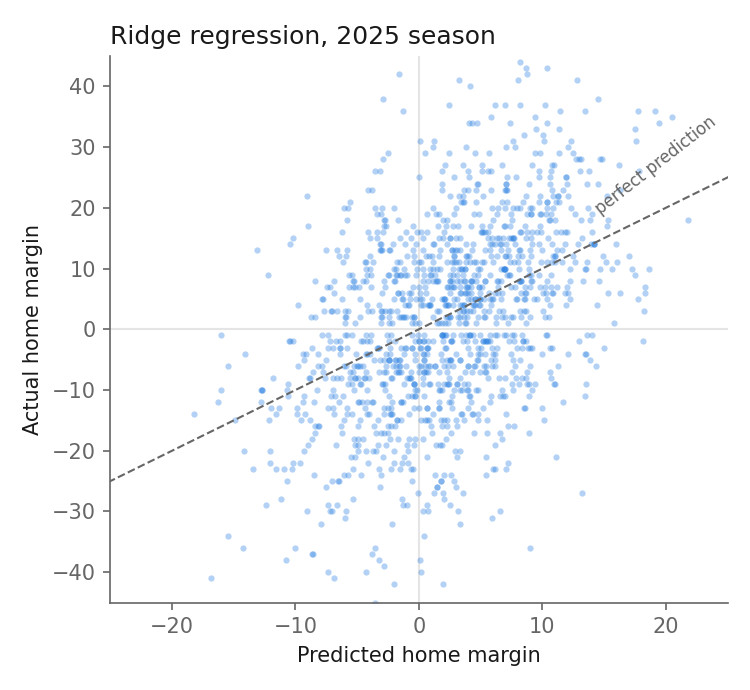
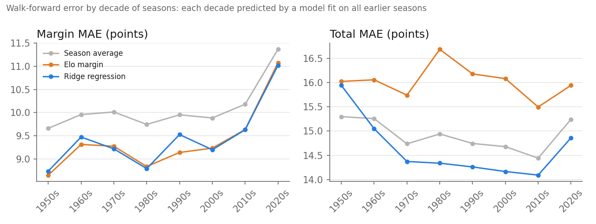

# NBA score predictor

Predicts the final score of an NBA game (home points, away points, and the margin and total that follow from them). It has two modes:

- **Pre-game:** uses only what was known before the game day.
- **In-game:** uses the pre-game inputs plus the score at halftime or after three quarters.

The data covers every season from the 1946-47 BAA through games played up to 25 November 2026: 73,440 games. Models are scored on whole seasons they never saw in training or tuning.

```text
$ predict --home NYK --away CLE --date 2026-11-25
CLE 107 @ NYK 115   (margin +7.1 home, total 221.9, pre-game, model: ridge)

$ predict --home NYK --away CLE --date 2026-11-25 --halftime 56-61
CLE 114 @ NYK 114   (margin +0.1 home, total 227.6, in-game from halftime 56-61)
```

The real game ended 121-102 to New York, after Cleveland led 61-56 at halftime.

## Results

Seasons are named by the year they end, so 2025 means 2024-25.

- **Tuning:** validation on 2024, with models fit on 1947-2023 (69,214 games). This step picks the recency weighting, the gradient-boosting settings, and which model the CLI uses.
- **Test:** 2025 (1,315 games), regular season, play-in and playoffs. Models are fit on every season before it.
- **Further unseen seasons:** 2026, the most recent complete season, is scored the same way with models fit through 2025. So is 2027, the season in progress, with models fit through 2026.

Pre-game, test season 2025:

| Model | Home pts MAE | Away pts MAE | Margin MAE | Total MAE | Winner acc. |
| --- | --- | --- | --- | --- | --- |
| Season average | 9.50 | 9.59 | 11.61 | 15.05 | 65.4% |
| Elo margin | 9.73 | 9.87 | 11.29 | 15.91 | 64.5% |
| Ridge regression | 9.21 | 9.24 | 11.11 | 14.63 | 65.7% |
| Gradient boosting | 9.25 | 9.32 | 11.12 | 14.75 | 65.9% |

MAE is mean absolute error in points. Picking the home team every time would have been right in 54.5% of 2025 games.


The gaps below are ridge minus baseline, with 95% intervals from a paired bootstrap over the test games (5,000 resamples, stored in `reports/results.json`):

| | 2025 (test) | 2026 |
| --- | --- | --- |
| Margin MAE vs Elo | -0.18 (-0.28 to -0.07) | -0.11 (-0.24 to +0.01) |
| Winner accuracy vs Elo | +1.2 pts (-0.5 to +3.0) | +1.7 pts (0.0 to +3.6) |
| Total MAE vs season average | -0.42 (-0.66 to -0.19) | -0.23 (-0.47 to +0.01) |
| Total MAE vs Elo | -1.29 (-1.68 to -0.89) | -0.90 (-1.30 to -0.51) |

- **Margin and winner:** ridge's margin MAE beats a standard Elo rating by about 0.1 to 0.2 points. That gap is clear of zero in 2025 and on the edge in 2026. Winner accuracy is 1 to 2 points higher, and both intervals touch zero.
- **Totals:** the gain is larger. Elo has no view of scoring level beyond the league average, and the box-score features (offensive and defensive rating, pace) give the model one.
- **Gradient boosting vs ridge:** boosting is within 0.12 points of ridge on every error metric in both seasons, so the extra flexibility bought nothing. The CLI uses ridge because it scored better on the validation season.

Pre-game, 2026 (1,322 games): ridge margin MAE 11.49 and total MAE 15.20, against 11.60 and 16.10 for Elo and 12.03 and 15.43 for the season average. Winner accuracy: 69.3% for ridge, 67.5% for Elo, and 55.5% for picking the home team. The 270 games of 2027 played so far give ridge 11.23 and 15.33. All tables are in [reports/results.md](reports/results.md).

The scatter shows why errors stay large: for any predicted margin, actual margins spread over 30 points or more.



### In-game

In-game results for test season 2025, every game with quarter scores:

| Checkpoint | Model | Margin MAE | Total MAE | Winner acc. |
| --- | --- | --- | --- | --- |
| Halftime | In-game ridge | 8.70 | 11.00 | 75.4% |
| Halftime | Score + pre-game share | 8.90 | 10.96 | 75.3% |
| Halftime | Pace extrapolation | 13.78 | 14.45 | 73.0% |
| End of Q3 | In-game ridge | 6.20 | 7.80 | 81.8% |
| End of Q3 | Score + pre-game share | 6.32 | 7.87 | 82.3% |
| End of Q3 | Pace extrapolation | 7.88 | 8.62 | 82.8% |

The baselines:

- *Pace extrapolation:* scales the current score to 48 minutes.
- *Score + pre-game share:* adds the pre-game prediction for the minutes still to play (half of it at halftime, a quarter of it after Q3).

The learned in-game model is only slightly better than the second baseline, and slightly worse on halftime totals. Most of what the score at a checkpoint says about the final is captured by "score so far plus a share of the pre-game estimate".

### Error by decade

The decade check is walk-forward: each decade of seasons is predicted by a model fit on all earlier seasons.



- **Totals:** ridge is best from the 1960s on. In the 1950s the season average does better (15.30 vs 15.94), because the model had only a few seasons of history, with scoring that was still changing fast.
- **Margin:** ridge and Elo stay within about 0.4 points of each other in every decade, and Elo wins in the 1950s, 1960s and 1990s. In the 1990s the model had only four seasons with box scores to learn from (box scores start in 1985-86). That fits ridge's weaker margin result there.
- **The 2020s:** every model's error rises. Scoring and its spread grew: the season average's total MAE went from 14.44 in the 2010s to 15.24.

## Data

| Seasons | Source | Licence |
| --- | --- | --- |
| 1946-47 to 1953-54 | [FiveThirtyEight NBA Elo](https://github.com/fivethirtyeight/data/tree/master/nba-elo), final scores only | CC BY 4.0 |
| 1954-55 to 2026-27 (to date) | [eoinamoore, "Historical NBA Data and Player Box Scores"](https://www.kaggle.com/datasets/eoinamoore/historical-nba-data-and-player-box-scores) on Kaggle, sourced from NBA.com. Includes quarter scores and team box scores. | CC0-1.0 |

The Kaggle dataset lists games back to 1946-47 but is missing many of them before 1954-55. FiveThirtyEight supplies those seasons instead. Both sources cover 1954-55 to 2014-15, and the training run compares them game by game. 56,009 of 56,014 games match on teams and date, and 55,942 of those have the same final score.

[DATA.md](DATA.md) has the details:

- licences and attribution
- file checksums
- the team mapping across relocations
- games per season, and the seasons with gaps in quarter scores or box scores

## Method

**Features** (`src/nbapred/features.py`). Games are replayed in date order. Every game on a date gets its features from the state at the end of the previous date, and only then are that date's results applied. Per team:

- Elo rating (K=20, 100-point home-court edge, margin-of-victory multiplier, 25% regression to the mean between seasons)
- season-to-date points scored and allowed, shrunk toward last season's averages (8 games of prior weight)
- points scored and allowed over the last 10 games
- offensive and defensive rating (points per 100 possessions) and pace (possessions per 48 minutes), season to date and shrunk the same way. Possessions are estimated from the box score (FGA + 0.44 FTA - OREB + TOV). These are blank before 1985-86, when box scores become complete.
- days of rest (capped at 10) and games played this season

The model also gets the Elo gap and playoff and neutral-site flags. Two league-wide features act as the era signal: season-to-date scoring and pace. These matter because a 1950s game and a 2020s game score very differently. The run also tried recency weighting: the training weight halves every 10 or 20 seasons back. Neither beat equal weights on the validation season (team-points MAE 9.258 equal, 9.298 with a 10-season half-life, 9.280 with 20), so equal weights are used.

Teams are keyed by NBA team id, which stays the same through moves and renames (Minneapolis to Los Angeles Lakers, Seattle to Oklahoma City, New Jersey to Brooklyn). The FiveThirtyEight seasons map onto the same ids.

**Baselines** (`src/nbapred/models.py`):

- *Season average:* each team's points scored so far, averaged with the opponent's points allowed so far.
- *Elo margin:* margin = (Elo gap + home edge) / 28, total = twice the league's season-to-date average.

**Learned models.** There is one regressor for home points and one for away points. The margin and total come from the two predictions. The ridge model imputes blank features with the training mean and adds a was-missing indicator for each. The other learned model is scikit-learn's `HistGradientBoostingRegressor`, with three settings tried on the validation season.

**In-game model** (`src/nbapred/ingame.py`). A ridge regression predicts the points each team scores after the checkpoint. It uses the pre-game features and the score at the checkpoint.

**Leakage guard.** `tests/test_leakage.py` picks a cutoff date and rewrites every result column of every game on or after it with random numbers. The rewritten columns are final scores, halftime and Q3 scores, possessions and minutes. The test then rebuilds the features and asserts that features for every game up to and including the cutoff day are unchanged. It also checks that the rating and pace features after the cutoff did change, so the test can't pass by accident. Other checks:

- In-game inputs don't depend on the game's own final score.
- The CLI's feature path gives the same numbers as the training path.
- The splits are by season.

## How to run

Python 3.10 or newer, CPU only. The Kaggle download needs a Kaggle account and an API token in `~/.kaggle/` (see the [Kaggle API docs](https://www.kaggle.com/docs/api)).

```bash
python -m venv .venv
source .venv/bin/activate        # Windows: .venv\Scripts\activate
pip install -e ".[dev,data]"

nbapred-train                    # downloads both sources (about 63 MB on disk), trains, writes reports/
predict --home BOS --away LAL --date 2026-12-01
predict --home BOS --away LAL --date 2026-12-01 --q3 80-84
pytest                           # 33 tests on small bundled fixtures, no network needed
```

The training run takes about 2 minutes on a laptop once the data is downloaded. About 30 seconds of that is the game-by-game overlap check between the two sources.

The options are listed by `nbapred-train --help` and `predict --help`:

- `nbapred-train`: `--source stitched|538|kaggle`, the validation season and the test season
- `predict`: `--neutral`, `--playoffs`, `--halftime H-A` and `--q3 H-A`

Team codes are the current NBA ones (`BKN`, `PHX`, `CHA`). Basketball-Reference codes (`BRK`, `PHO`, `CHO`) and historical codes (`SEA`, `NJN`) also work.

## Project layout

```text
src/nbapred/
  data.py         FiveThirtyEight download, checksum, one row per game; team-code aliases
  kaggle_data.py  Kaggle download (official API), one row per game with quarter scores and possessions
  combine.py      stitch the two sources, team-id mapping, overlap check, coverage table
  features.py     Elo, rolling scoring and box-score rates, replayed date by date
  models.py       baselines, ridge, gradient boosting, recency weights, metrics, bootstrap
  ingame.py       halftime / end-of-Q3 model and baselines
  train.py        tune on validation, score held-out seasons, decade check, reports
  plots.py        report plots
  cli.py          predict command
tests/            leakage, loaders, stitching, features, models, end-to-end pipeline
reports/          results.json, results.md, coverage.csv, plots
```

## Limitations

- **No player information:** injuries, rest days for stars, trades and lineups are invisible to the model. The dataset has player box scores, but minutes played are known only after a game. No injury or availability data is used.
- **No betting lines,** so there is no comparison against the market.
- **One test season,** plus one more unseen full season. The bootstrap intervals cover game-to-game noise within a season, not variation between seasons.
- **Quarter-score gaps:** quarter scores are missing for almost all of 2021-22 and about half of 2000-01. The in-game model trains on the games that have them.
- **Neutral sites:** the neutral-site flag covers the 2020 bubble, NBA Cup knockout games in Las Vegas and games the source labels "Global Games". Neutral-site games outside those groups, such as older international games the source doesn't label, are treated as home games.
- **Live predictions** for the current season use ratings as of the last game in the downloaded data. Re-run `nbapred-train` to refresh it.

## Licence

Code: MIT, see [LICENSE](LICENSE). Data: CC0-1.0 (Kaggle dataset, from NBA.com) and CC BY 4.0 (FiveThirtyEight); see [DATA.md](DATA.md).
