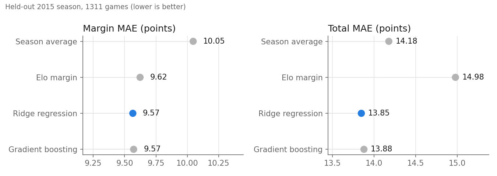

# NBA score predictor

Predicts the final score of an NBA game (home points, away points, and the margin and total that follow from them) using only what was known before tip-off. Four models are compared on a held-out season that none of them saw during training or tuning: two simple baselines, a ridge regression and a gradient-boosted tree model.

```text
$ predict --home GSW --away CLE --date 2015-06-04 --playoffs
CLE 97 @ GSW 103   (margin +6.6 home, total 200.2, model: ridge)
```

The real game, Game 1 of the 2015 Finals, ended 108-100 to Golden State.

## Results

Held-out test season: 2014-15, regular season and playoffs, 1,311 games. Models train on 1989-90 to 2012-13 (29,566 games). 2013-14 is the validation season, used to pick the gradient-boosting settings and which model the CLI uses. The learned models are then refit on train plus validation and scored once on 2014-15.

| Model | Home pts MAE | Away pts MAE | Margin MAE | Total MAE | Winner acc. |
| --- | --- | --- | --- | --- | --- |
| Season average | 8.69 | 8.82 | 10.05 | 14.18 | 66.5% |
| Elo margin | 8.98 | 9.00 | 9.62 | 14.98 | 66.6% |
| Ridge regression | 8.52 | 8.55 | 9.57 | 13.85 | 67.2% |
| Gradient boosting | 8.53 | 8.58 | 9.57 | 13.88 | 67.6% |

MAE is mean absolute error in points. Picking the home team every time would have been right in 57.6% of 2014-15 games.



Gaps below are ridge minus baseline, with 95% intervals from a paired bootstrap over the test games (5,000 resamples; stored in `reports/results.json`).

- **Who wins and by how much:** the learned models do not beat a standard Elo rating (FiveThirtyEight's published settings, not tuned here). Ridge's margin MAE is 0.06 points lower than Elo's (9.566 vs 9.624), with an interval of -0.13 to +0.01. Winner accuracy is 0.6 percentage points higher, with an interval of -0.7 to +1.9. Both intervals include zero.
- **Total points:** the learned models help here. Ridge's total MAE is 0.33 points lower than the season-average baseline (interval -0.51 to -0.14) and 1.13 points lower than Elo's league-average total (interval -1.49 to -0.77).
- **Gradient boosting vs ridge:** boosting is within 0.03 points of ridge on every error metric, so the extra flexibility bought nothing on about 30,000 training games. The CLI uses ridge because it had the lower team-score MAE on the validation season.

The scatter below shows why the errors stay large: for any predicted margin, actual margins spread over 30 points or more.


## Data

The [FiveThirtyEight NBA Elo dataset](https://github.com/fivethirtyeight/data/tree/master/nba-elo) (`nbaallelo.csv`), licensed CC BY 4.0. It has every NBA and ABA game from 1946-47 through the 2015 Finals. Only teams, dates, locations and final scores are used. FiveThirtyEight's own Elo columns are ignored, because the post-game ratings would leak results; this project computes its own ratings. Details, licence and attribution are in [DATA.md](DATA.md).

The data ends in June 2015. Predictions for later dates use each team's rating and averages as of that point, carried into a new season the same way as any off-season (see Limitations).

## Method

**Features** (`src/nbapred/features.py`). Games are replayed in date order. Every game on a date gets its features from the state at the end of the previous date, and only then are that date's results applied. Per team:

- Elo rating (K=20, 100-point home-court edge, margin-of-victory multiplier, 25% regression to the mean between seasons)
- season-to-date points scored and allowed, shrunk toward last season's averages for the first few games (8 games of prior weight)
- points scored and allowed over the last 10 games
- days of rest (capped at 10) and games played this season

Plus the Elo gap, the league's season-to-date scoring average, and playoff and neutral-site flags. Teams are keyed by franchise, so ratings carry across moves and renames (Seattle to Oklahoma City, New Jersey to Brooklyn).

**Baselines** (`src/nbapred/models.py`):

- *Season average:* each team's points scored so far, averaged with the opponent's points allowed so far.
- *Elo margin:* margin = (Elo gap + home edge) / 28, total = twice the league's season-to-date average.

**Learned models:** one regressor for home points and one for away points; margin and total come from the two predictions. Ridge regression on standardized features, and scikit-learn's `HistGradientBoostingRegressor` with three settings tried on the validation season.

**Leakage guard.** `tests/test_leakage.py` rewrites the scores of every game on or after a cutoff date with random numbers, rebuilds the features, and asserts that features for every game up to and including the cutoff day are unchanged. It covers both future games and other games played the same day. Changing the code to apply each result as soon as its game is processed makes this test fail; that was checked by hand. A second test confirms the CLI's feature path gives the same numbers as the training path. The train, validation and test split is by season.

## How to run

Python 3.10 or newer, CPU only. The full pipeline takes about 20 seconds on a laptop.

```bash
python -m venv .venv
source .venv/bin/activate        # Windows: .venv\Scripts\activate
pip install -e ".[dev]"

nbapred-train                    # downloads the data (18 MB, checksum-verified), trains, writes reports/
predict --home BOS --away LAL --date 2015-03-01
pytest                           # 18 tests on a small bundled fixture, no network needed
```

`nbapred-train --help` and `predict --help` list the options (training start season, test season, neutral site, playoffs). Team codes are Basketball-Reference style (`BRK`, `PHO`, `CHO`); `BKN`, `PHX` and `CHA` also work.

## Project layout

```text
src/nbapred/
  data.py       download, checksum, load one row per game
  features.py   Elo and rolling features, replayed date by date
  models.py     baselines, ridge, gradient boosting, metrics
  train.py      split, tune on validation, test, reports and plots
  cli.py        predict command
tests/          leakage, features, models, end-to-end pipeline
reports/        results.json, results.md, plots
```

## Limitations

- The data stops at the 2015 Finals. The league has changed since (more three-pointers, higher scoring), so the 2014-15 test numbers describe that era, and predictions for current games use stale ratings. Adding recent seasons needs a new data loader.
- No player information: injuries, rest days for stars, trades and lineups are invisible to the model.
- No betting lines, so there is no comparison against the market.
- Only one test season. The bootstrap intervals cover game-to-game noise within that season, not variation between seasons.
- Pre-game only. There is no in-game mode (for example, predicting the final from the halftime score), because this dataset has final scores only.

## Licence

Code: MIT, see [LICENSE](LICENSE). Data: CC BY 4.0, FiveThirtyEight; see [DATA.md](DATA.md).
